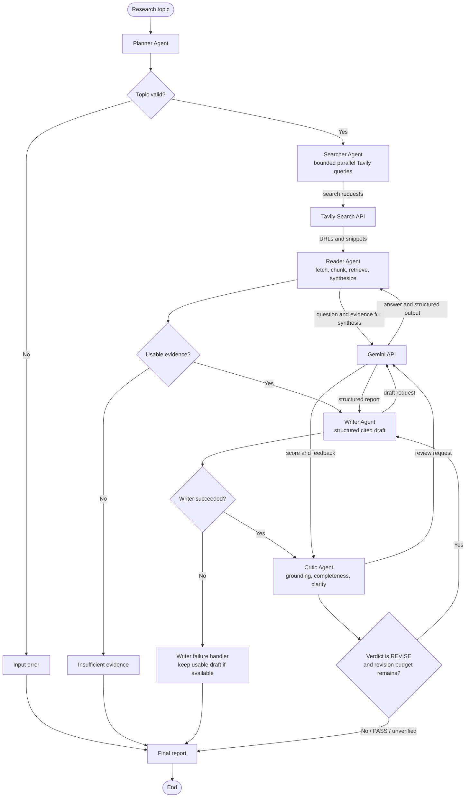
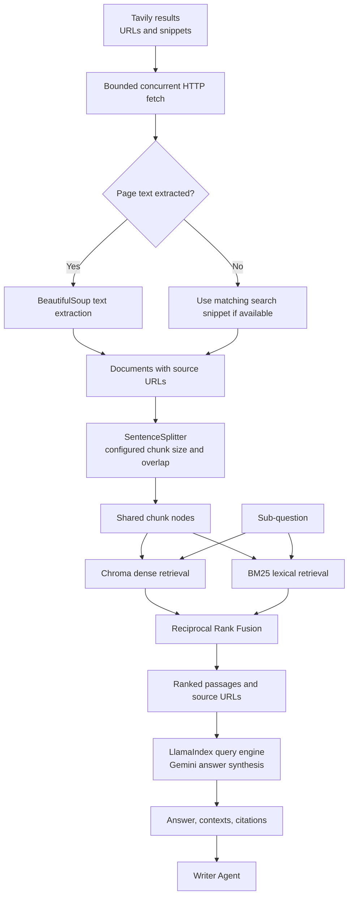

# AutoResearch

### Five-Agent Autonomous Research System

AutoResearch turns a research topic into a cited report through question planning, web search, hybrid evidence retrieval, structured writing, and critic review. It is a portfolio engineering project for exploring multi-agent orchestration and retrieval evaluation; it is not a production research or fact-checking service.

[](https://www.python.org/)
[](https://docs.langchain.com/oss/python/langgraph/overview)
[](https://streamlit.io/)
[](https://ai.google.dev/gemini-api/docs)
[](https://docs.trychroma.com/)
[](https://www.docker.com/)

## Contents

- [Overview](#overview)
- [Architecture](#architecture)
- [The five agents](#the-five-agents)
- [Hybrid retrieval](#hybrid-retrieval)
- [Evaluation and quality control](#evaluation-and-quality-control)
- [Technology stack](#technology-stack)
- [Project structure](#project-structure)
- [Installation and setup](#installation-and-setup)
- [Configuration](#configuration)
- [Testing](#testing)
- [Observability](#observability)
- [Limitations and trade-offs](#limitations-and-trade-offs)
- [Possible next steps](#possible-next-steps)
- [References](#references)

## Overview

Research questions often need several web searches and a synthesis that keeps its evidence attached. AutoResearch explores that workflow as a small multi-agent system: a planner separates a topic into three questions, a searcher gathers candidate pages, a reader retrieves passages for each question, a writer drafts the report, and a critic can request revisions.

The agents exchange data through a shared [LangGraph state](schemas/state.py). The graph owns the sequence and conditional routing; Pydantic models define structured planner, writer, and critic outputs. Search and page fetch work can overlap, while the Reader combines semantic and lexical rankings with Reciprocal Rank Fusion (RRF).

Quality checks have two distinct roles: interactive RAGAS diagnostics for a run, and a small curated reference set for comparing retrieval and answer quality. Neither the Critic score nor an LLM-judged metric proves factual accuracy.

## Architecture

The graph has terminal paths for invalid input, unusable reader output, and writer failure. Successful writing goes through the Critic; a `REVISE` verdict loops to the Writer up to the configured two revisions. A critic failure finalizes the best available draft with an unverified note.



### Reader retrieval flow



## The five agents

| Agent | Responsibility | Input | Output | Implementation details |
|---|---|---|---|---|
| **Planner** | Breaks the topic into focused research questions. | Topic | Three sub-questions | Validates exactly three distinct questions. If planning errors or output is invalid, creates three deterministic questions about context, evidence/developments, and impacts/open questions. |
| **Searcher** | Finds candidate web pages for each question. | Sub-questions | Results with title, URL, and snippet | Runs independent Tavily queries in a bounded thread pool (`SEARCH_CONCURRENCY`); requests up to three basic-search results per question and records per-query errors and durations. |
| **Reader** | Fetches pages and answers each question from retrieved passages. | Search results and snippets | Answers, contexts, source URLs, timings | Fetches unique URLs concurrently, extracts page text with BeautifulSoup, and falls back to a search snippet if fetching or extraction fails. Chunks with `SentenceSplitter`, indexes in ephemeral Chroma, runs dense and BM25 retrieval, and fuses rankings with RRF before Gemini synthesis. |
| **Writer** | Produces the structured report and revises it when asked. | Questions and Reader evidence; optionally critic feedback | Introduction, one finding per question, conclusion | Uses a Pydantic `DraftReport`. Citation alignment removes URLs not retrieved for that question, fills omitted citations from allowed sources when available, and reports adjustments. Revision is capped at two cycles. |
| **Critic** | Reviews the draft's grounding, completeness, and clarity. | Draft, evidence, citation-check notes | Integer score (1–10), issues, `PASS` or `REVISE` | Uses a structured LLM-as-judge response. It can request a revision; it does not independently verify sources or guarantee correctness. If it fails, the graph keeps the best available draft and marks it unverified. |

## Hybrid retrieval

The Reader retrieves over the same set of text chunks using two methods:

- **Dense retrieval** embeds passages and the question, then searches Chroma for semantic similarity. It can surface passages that use different wording from the query.
- **BM25 retrieval** ranks lexical overlap using query terms. It can help with names, identifiers, and exact terminology that semantic similarity may not prioritize.
- **Reciprocal Rank Fusion** combines the two ranked lists by rank position, so their raw score scales do not need to match. In this project the Reader uses:

```text
RRF(d) = sum over retrievers r of 1 / (k + rank_r(d))
```

Here, `d` is a chunk, `rank_r(d)` is its one-based position in retriever `r` (and it contributes only when present), and `k` is the rank-smoothing constant configured by `RRF_K`. The highest fused chunks, up to `RETRIEVAL_TOP_K`, are passed to the LlamaIndex query engine for answer synthesis.

The Chroma index is created with `chromadb.EphemeralClient()` for each Reader run. It is not a persistent knowledge base. RRF follows the rank-fusion approach described in [Reciprocal Rank Fusion Outperforms Condorcet and Individual Rank Learning Methods](https://research.google/pubs/reciprocal-rank-fusion-outperforms-condorcet-and-individual-rank-learning-methods/).

## Evaluation and quality control

### Interactive RAGAS diagnostics

The Streamlit sidebar can enable four metrics for a research run:

| Metric | What it indicates | Reference limitation |
|---|---|---|
| Faithfulness | Whether the generated answer is supported by retrieved contexts, estimated by an LLM judge. | Judge estimate, not ground truth. |
| Answer relevancy | Whether the answer addresses the question, estimated by an LLM judge. | Judge estimate, not ground truth. |
| Context precision | Whether retrieved context is relevant to the answer. | The live run uses the generated answer as its own proxy reference. |
| Context recall | Whether context covers the reference answer. | The live run uses the generated answer as its own proxy reference. |

The UI labels the first pair as judge estimates and the latter pair as proxy scores. They are useful diagnostics, not independent proof of correctness. Enabling RAGAS adds model-judge calls and runtime; the exact cost and duration depend on the run and provider.

### Human-referenced golden set

[`evaluation/golden_set.json`](evaluation/golden_set.json) currently contains five fixed questions, human-written expected answers, and curated reference URLs. The runner performs Tavily search and Reader retrieval, then reports:

- Per-case and average RAGAS metrics against the expected answers. Faithfulness and answer relevancy remain judge estimates; context precision, context recall, and answer correctness use the curated references.
- Expected source-domain coverage: whether the retrieved source domains include the expected domains. This is a source-discovery check, not a measure of claim accuracy.
- A JSON report with answers, sources, timings, errors, and metrics in `evaluation/results/` (ignored by Git).

Run the full set with RAGAS:

```powershell
python evaluation/run_golden_eval.py
```

Run one case and skip RAGAS:

```powershell
python evaluation/run_golden_eval.py --limit 1 --skip-ragas
```

Both commands make live Tavily and Gemini calls for search and Reader synthesis. Skipping RAGAS avoids its additional judge evaluation; it does not make the benchmark offline. Runs may use paid API quota and take time. Five cases are a small regression set and do not establish broad generalization.

## Technology stack

| Area | Technologies used | Role |
|---|---|---|
| Language | Python 3.13 | Application and evaluation code |
| Orchestration | LangGraph | Agent state, graph execution, and conditional routing |
| LLM integration | Gemini through LangChain Google GenAI and LlamaIndex Google GenAI | Planner, Reader synthesis, Writer, Critic, and RAGAS judge |
| Web search | Tavily Python client | Search for each planned question |
| Page retrieval | HTTPX, BeautifulSoup | Concurrent page fetching and text extraction |
| Retrieval | LlamaIndex, BM25, custom RRF fusion | Dense and lexical retrieval and ranking fusion |
| Embeddings | Sentence Transformers, `BAAI/bge-small-en-v1.5` | Dense vector representations |
| Vector store | ChromaDB | Per-run ephemeral dense index |
| Evaluation | RAGAS, Hugging Face Datasets | Interactive metrics and reference-based benchmark |
| UI | Streamlit | Chat interface, run trace, metrics, and report download |
| Observability | LangSmith | Optional hosted traces; local trace and timings are shown in the app |
| Containerization | Docker, Docker Compose | Reproducible local container run |
| Tests | pytest | Routing and helper unit tests; install separately for development |

## Project structure

```text
.
├── app.py                         Streamlit entry point
├── agents/                        Planner, Searcher, Reader, Writer, Critic
├── clients/                       Gemini and Tavily client setup
├── config/settings.py             Environment loading and runtime defaults
├── evaluation/
│   ├── golden_set.json             Curated questions, answers, and source URLs
│   ├── run_golden_eval.py          Live reference-based benchmark runner
│   └── ragas_eval.py                Interactive RAGAS diagnostics
├── graph/                         LangGraph nodes, routing, and terminal paths
├── schemas/                       Shared graph state and Pydantic output models
├── testers/
│   ├── test_routing.py             Routing unit tests
│   ├── test_helper.py              Helper unit tests
│   └── run_e2e_topics.py           Live API end-to-end runner
├── ui/                             Streamlit views and styling
├── utils/helpers.py                Retry, evidence, citation, and report helpers
├── .env.example                    Environment variable template
├── requirements.in                 Pinned direct dependencies
├── requirements.txt                Fully pinned dependency lock
├── Dockerfile
└── compose.yaml
```

## Installation and setup

### Prerequisites

- Python 3.13 (the Docker image uses Python 3.13).
- A [Google AI Studio API key](https://aistudio.google.com/app/apikey) for Gemini.
- A [Tavily API key](https://app.tavily.com/) for web search.
- Optional: a LangSmith API key for hosted traces.
- Docker Desktop only if using the container workflow.

### Run locally on Windows

From the repository root in PowerShell:

```powershell
python -m venv .venv
.\.venv\Scripts\Activate.ps1
python -m pip install --upgrade pip
python -m pip install -r requirements.txt
Copy-Item .env.example .env
notepad .env
streamlit run app.py
```

Enter your own keys in `.env`; keep this file private. Start Streamlit and open the local URL it prints (normally `http://localhost:8501`). To stop it, press `Ctrl+C` in that terminal.

### Run with Docker

Install and start Docker Desktop. From the repository root, create `.env` from `.env.example` and add the required keys, then run:

```powershell
Copy-Item .env.example .env
notepad .env
docker compose up --build
```

Open [http://localhost:8501](http://localhost:8501). Stop the foreground run with `Ctrl+C`; optionally remove the stopped container with `docker compose down`. Compose passes `.env` at runtime; `.dockerignore` excludes it from the image build context. The embedding model downloads on first use and the named `huggingface-cache` volume retains its cache between container runs.

## Configuration

Project settings are read in [`config/settings.py`](config/settings.py), [`clients/llm_clients.py`](clients/llm_clients.py), and [`clients/search_client.py`](clients/search_client.py). Required credentials have no built-in key values; `.env.example` contains placeholders only.

| Variable | Default | Purpose |
|---|---|---|
| `GOOGLE_API_KEY` | None (required) | Gemini API credential. `GEMINI_API_KEY` is accepted as an alias if this is unset. |
| `GEMINI_API_KEY` | None | Optional alias for `GOOGLE_API_KEY`. |
| `TAVILY_API_KEY` | None (required) | Tavily web search credential. |
| `GEMINI_MODEL` | `gemini-3.5-flash-lite` | Model name passed to both Gemini integrations. |
| `SEARCH_CONCURRENCY` | `3` | Maximum concurrent Tavily search tasks. |
| `FETCH_CONCURRENCY` | `6` | Maximum concurrent page fetches and HTTP connections. |
| `FETCH_TIMEOUT_SECONDS` | `12` | HTTP page-fetch timeout in seconds. |
| `CHUNK_SIZE` | `800` | SentenceSplitter chunk size. |
| `CHUNK_OVERLAP` | `120` | SentenceSplitter overlap. |
| `RETRIEVAL_TOP_K` | `6` | Candidate count for each retriever and final RRF results. |
| `RRF_K` | `60` | RRF rank-smoothing constant. |
| `LANGSMITH_TRACING` | `true` unless overridden by legacy variable | Enables LangSmith tracing when a LangSmith key is set. |
| `LANGSMITH_PROJECT` | `AutoResearch` unless overridden by legacy variable | LangSmith project name. |
| `LANGSMITH_API_KEY` | None | Optional LangSmith credential; `LANGCHAIN_API_KEY` is accepted as an alias. |
| `LANGCHAIN_TRACING_V2` | `true` | Legacy tracing flag used if `LANGSMITH_TRACING` is unset. |
| `LANGCHAIN_PROJECT` | `AutoResearch` | Legacy project name used if `LANGSMITH_PROJECT` is unset. |
| `LANGCHAIN_API_KEY` | None | Legacy alias used if `LANGSMITH_API_KEY` is unset. |
| `HF_HOME` | Hugging Face library default locally; `/home/app/.cache/huggingface` in Docker | Embedding model cache location. Docker Compose persists this directory in a named volume. |
| `STREAMLIT_SERVER_HEADLESS` | `true` in Docker | Run Streamlit without opening a browser in the container. |
| `STREAMLIT_SERVER_ADDRESS` | `0.0.0.0` in Docker | Bind the container server to all interfaces. |
| `STREAMLIT_SERVER_PORT` | `8501` in Docker | Streamlit port exposed by Compose. |
| `PYTHONDONTWRITEBYTECODE` | `1` in Docker | Prevent Python from writing bytecode files into the image/container. |
| `PYTHONUNBUFFERED` | `1` in Docker | Send Python output to container logs without buffering. |
| `PIP_NO_CACHE_DIR` | `1` in Docker | Avoid retaining pip's download cache in the image. |

The last seven variables are Docker image/runtime settings, not entries in `.env.example`; they are normally left at the Dockerfile defaults.

`MAX_REVISIONS` (2) and `MAX_CONTEXT_CHARS` (4000) are code constants, not environment variables. The dependency inputs are pinned in `requirements.in`; `requirements.txt` locks direct and transitive versions. To intentionally update the lock, install `pip-tools` and run:

```powershell
python -m pip install pip-tools
pip-compile --upgrade requirements.in --output-file requirements.txt
```

## Testing

The two fast test files make no model or search API calls. `pytest` is not included in the runtime dependency lock, so install it in the active virtual environment first:

```powershell
python -m pip install pytest
python -m pytest testers/test_routing.py testers/test_helper.py -v
```

The end-to-end runner and golden set call live services:

```powershell
python testers/run_e2e_topics.py --limit 1 --no-ragas
python evaluation/run_golden_eval.py --limit 1 --skip-ragas
```

The first command runs the full graph for one topic, including Gemini planning/writing/critique and Tavily search, while disabling interactive RAGAS. The second directly tests one fixed search-and-retrieval case against expected source domains, without RAGAS. Both require valid API keys and may use provider quota. Run the full reference evaluation with `python evaluation/run_golden_eval.py` as described above.

## Observability

- **Local agent trace:** the Streamlit conversation shows graph steps and an expandable trace for the current run. This is rendered in the app session.
- **Runtime breakdown:** the UI records total time for Planner, Searcher, Reader, Writer, and Critic, plus Reader fetch, indexing, question retrieval, and RAGAS stages. Searcher records per-question timings and errors in graph state (errors are also logged); Reader records per-URL fetch timings and errors in graph state (fetch errors and snippet fallbacks are logged).
- **LangSmith:** when tracing is enabled and `LANGSMITH_API_KEY` (or its legacy alias) is configured, decorated agent calls can be sent to the configured LangSmith project. Hosted traces are separate from the local Streamlit trace. Set `LANGSMITH_TRACING=false` to disable tracing.

## Limitations and trade-offs

- Chroma uses an ephemeral in-memory client for each Reader run; it does not preserve an index across topics or restarts.
- Research history is stored in Streamlit session state, not a durable database.
- Search depends on Tavily and synthesis/review depends on Gemini availability, quotas, and responses.
- Search snippets are less complete than successfully fetched pages; some sites may block or limit automated fetching.
- The Critic is an LLM judge and citation alignment is at the finding/source level. Neither verifies every claim or guarantees correctness.
- Interactive RAGAS context precision/recall use a generated-answer proxy reference. Their scores should not be read as independent correctness measures.
- The five-case golden set is too small to establish broad reliability or generalization.
- The project has no `LICENSE` file, so reuse and distribution terms are not specified.

## Possible next steps

These are ideas for future work, not current features:

- Expand the golden set with reviewed questions, expected answers, and trusted source references from target domains.
- Add persistent research history and a persistent, versioned index if repeat research is needed.
- Evaluate source credibility and claim-to-passage support more directly.
- Cache searches and fetched pages with explicit freshness controls.
- Compare retrieval settings and rerankers using a repeatable labeled evaluation set.

## References

- [LangGraph documentation](https://docs.langchain.com/oss/python/langgraph/overview)
- [Gemini API documentation](https://ai.google.dev/gemini-api/docs)
- [Tavily Search API documentation](https://docs.tavily.com/documentation/api-reference/endpoint/search)
- [Chroma documentation](https://docs.trychroma.com/)
- [RAGAS documentation](https://docs.ragas.io/)
- [LangSmith tracing documentation](https://docs.smith.langchain.com/observability/how_to_guides/trace_with_langchain)
- [Okapi BM25, Introduction to Information Retrieval](https://nlp.stanford.edu/IR-book/html/htmledition/okapi-bm25-a-non-binary-model-1.html)
- [Reciprocal Rank Fusion paper](https://research.google/pubs/reciprocal-rank-fusion-outperforms-condorcet-and-individual-rank-learning-methods/)
